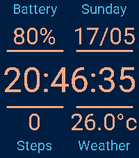
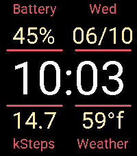
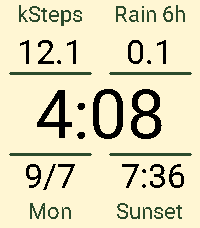
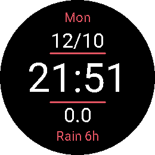

# Tempilation Pebble Watchface

Tempilation is a practical digital watchface with customizable colors and multiple modules to pick from.

Designer: SocketMix
Programmer: justinjhendrick
Inspired by: Samsung Galaxy Basic Dashboard

Features:
* The color of every element is configurable
* Support 12hr and 24hr time
* Support hrs:mins:seconds (always or only wake)
* Support hrs:mins
* Module Support
  * Temperature in Celsius or Fahrenheit
  * Date with DD/MM or MM/DD
  * Step Count
  * Battery Percentage
  * Heart Rate
  * Rain in next 1 hour or 6 hours
  * Sunrise & Sunset time
  * Watch Status (Quiet time & Bluetooth). Capital letter means On.

https://apps.repebble.com/cfcf110c62e6483eba7ef85a

## Screenshots

### Emery

### Gabbro

## Credits

* Designer: SocketMix
* Programmer: justinjhendrick
* Inspired by: Samsung Galaxy Basic Dashboard
